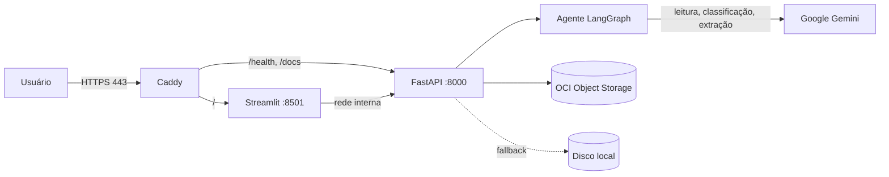
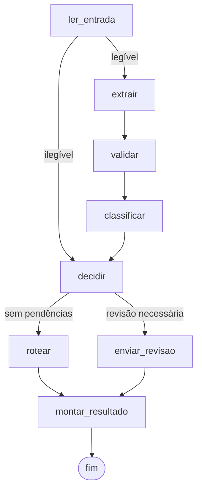

# MediFlow 🏥
### Agente Inteligente para Triagem, Extração e Roteamento de Documentos Clínicos


**MediFlow** é um agente de IA que recebe documentos clínicos (texto, PDF ou imagem), classifica o tipo de documento, extrai os dados relevantes, confere o que foi extraído contra o texto original e decide para qual setor o documento deve ir. Casos ambíguos, incompletos ou ilegíveis vão para revisão humana.

Desenvolvido no hackathon **Alura + Oracle Next Education (ONE)**.

> **Status:** MVP funcional, com API, agente LangGraph, interface Streamlit, testes automatizados, pipeline de CI/CD e deploy na OCI. Demonstração: [mediflow-oci.duckdns.org](https://mediflow-oci.duckdns.org). As pendências estão na seção [Roadmap](#-13-roadmap).

---

## 🎯 1. Problema e motivação

A triagem de documentos clínicos e administrativos envolve tarefas repetitivas: ler, classificar, extrair dados, conferir e encaminhar para o setor certo. Feita só à mão, ela gera gargalos, retrabalho e pouca rastreabilidade.

O MediFlow automatiza essa triagem inicial e mantém a revisão humana sempre que houver dúvida. **A IA organiza e encaminha; ela não faz diagnóstico nem decide conduta clínica.**

## ⚙️ 2. O que o MVP faz

| Funcionalidade | Como funciona |
|---|---|
| Recepção | Texto (JSON), PDF digital, PDF escaneado, JPG ou PNG. O formato é detectado pelos bytes iniciais do arquivo, não pelo nome nem pelo MIME. Limites: 10 MB por arquivo e 200.000 caracteres por texto. |
| Original preservado | O original é gravado em `recebidos/` **antes** de qualquer processamento e nunca é sobrescrito. Um ID repetido é recusado com `409`. |
| Leitura | PDF com texto: extração direta (pypdf/PyMuPDF). PDF escaneado ou imagem: transcrição pela visão do Gemini, com verificação de legibilidade. |
| Classificação e extração | Gemini com saída em JSON forçada por schema (Pydantic). O prompt proíbe inventar dados e trata o documento como dado, não como instrução. |
| Validação | Cada campo extraído é conferido contra o texto original (paciente, CRM, medicamentos, posologia, exames, código TUSS, CID-10). O score de confiança é **recalculado** com penalidades; o score do LLM não é usado diretamente. |
| Roteamento | Regras determinísticas, sem LLM (veja a seção 3). |
| Revisão humana | Score abaixo do limite, problemas de validação, campo obrigatório faltando, documento ilegível ou fora das categorias → `Fila_Revisao_Humana`, com os motivos listados. |
| Resultado | JSON validado contra o contrato antes de ser entregue. Se sair fora do formato, nenhuma resposta parcial é entregue: o documento vai para revisão com o motivo "falha de processamento". |

## 🗂️ 3. Categorias, destinos e regras

**Categorias** (fonte única: `app/modelos/classificacao.py`):

- Receituário Médico
- Laudo de Exame de Imagem
- Laudo Laboratorial
- Guia de Solicitação de Procedimento
- Relatório de Alta
- Atestado Médico
- Não identificado: documento fora das categorias clínicas (ex.: nota fiscal, contrato)
- Desconhecido: sem conteúdo clínico reconhecível

As duas últimas são válvulas de segurança e sempre vão para revisão humana.

**Regras de roteamento** (`app/roteamento.py`), avaliadas nesta ordem:

| Ordem | Regra | Condição | Destino |
|---|---|---|---|
| 1 | `R-REVISAO` | Score < limite, problema de validação, campo faltante, erro, ilegível, "Não identificado" ou "Desconhecido" | `Fila_Revisao_Humana` |
| 2 | `R-URGENCIA` | Prioridade "Urgente" | `Fila_Emergencia_Medica` + notificação `Alerta_Plantao_Medico` |
| 3 | `R-RECEITA` | Receituário Médico | `Farmacia_Hospitalar` |
| 3 | `R-GUIA` | Guia de Solicitação de Procedimento | `Auditoria_Autorizacoes` |
| 3 | `R-PRONTUARIO` | Laudos, Relatório de Alta, Atestado | `Prontuario_Eletronico` |

Um documento urgente com dados ambíguos vai para revisão humana, mas leva a notificação "Possível urgência com dados ambíguos: revisar com prioridade". Assim a urgência não se perde e um dado duvidoso não chega direto à emergência.

O limite de confiança padrão é **0.80**. Ele pode ser alterado em `config/regras.json` ou pela variável `LIMIAR_CONFIANCA`, que tem precedência.

### Score Global e Confiança de Campos Críticos (H4.1.1)

Para garantir que nenhum dado incerto siga desacompanhado de validação humana, o sistema calcula o **score global** combinando a classificação geral e a confiabilidade de cada campo extraído:

$$\text{score global} = \min(\text{score de classificação},\; \text{média dos scores dos campos})$$

- **Campos Críticos** (`config/regras.json`): `paciente.nome`, `medico_solicitante.crm`, `medicamentos.nome`, `medicamentos.dose` e `cid_sugerido`.
- **Regra de Barreira**:
  1. Se o $\text{score global} < 0.80$, o documento é barrado e encaminhado para `Fila_Revisao_Humana`.
  2. Mesmo com score global alto, se qualquer **campo crítico** apresentar confiança individual abaixo do limite (ex.: dose em $0.50$), o documento é encaminhado obrigatoriamente para revisão humana.


## 🧠 4. Arquitetura

UI e API são um **monolito**: a mesma imagem de container roda a API (FastAPI) e, num segundo container, a interface (Streamlit).



Se a OCI não estiver configurada ou falhar, o armazenamento cai automaticamente para o disco (`storage_local/`) e o campo `armazenamento_oci.local` mostra onde o resultado foi gravado.

### Fluxo do agente (LangGraph)

Grafo definido em `app/grafo.py`:



| Nó | Responsabilidade |
|---|---|
| `ler_entrada` | Detecta o formato, extrai o texto ou transcreve a imagem e verifica a legibilidade. Documento ilegível pula direto para `decidir`. |
| `extrair` | Chama o Gemini e devolve a extração no schema `Extracao`. |
| `validar` | Confere a extração contra o texto, recalcula o score e lista os campos obrigatórios faltantes. |
| `classificar` | Monta a classificação mostrada ao analista, com o score recalculado. |
| `decidir` | Aplica as regras da seção 3. |
| `rotear` / `enviar_revisao` | Registra o destino, a regra aplicada, a justificativa e a notificação. |
| `montar_resultado` | Monta e valida o `ResultadoTriagem`. Se falhar, envia o documento para revisão. |

## 🛠️ 5. Tecnologias

| Camada | Tecnologia |
|---|---|
| Interface | Streamlit |
| API | Python 3.13 + FastAPI |
| Agente | LangGraph |
| IA | Google Gemini (`google-genai`), com modelo principal e modelo de fallback configuráveis |
| Leitura de PDF | pypdf / PyMuPDF (sem OCR local; documentos escaneados usam a visão do Gemini) |
| Contratos | Pydantic |
| Armazenamento | OCI Object Storage, com fallback em disco |
| Dependências | uv, `requirements.txt` com hashes |
| Qualidade | pytest + cobertura, ruff, SonarQube, Trivy |
| Container | Imagem Wolfi (Chainguard), Podman ou Docker |
| CI/CD | GitHub Actions → OCI Container Registry (OCIR) |
| Infraestrutura | Terraform (OCI Compute Always Free), Podman Quadlets, Caddy |

## 🔄 6. Fluxo de processamento

1. **Recepção:** o documento chega pela UI ou pela API, e o ID e o formato são validados.
2. **Original:** o arquivo é gravado em `recebidos/` antes de qualquer outra coisa.
3. **Processamento:** o agente lê o original gravado, não o upload em memória, e percorre o grafo da seção 4.
4. **Resultado:** o JSON é validado contra o contrato.
5. **Arquivamento:** o resultado é gravado na pasta do destino (seção 8) e fica disponível em `GET /triagem/{id}`.

Por padrão o envio é assíncrono: a API responde `202` e processa em segundo plano. Com `?aguardar=true`, a resposta já traz o resultado (`200`).

## 📦 7. Estrutura do repositório

```text
.
├── app/                    # API, agente, revisão humana e regras
│   ├── api/                # rotas FastAPI (triagem, documentos, fila, decisão, histórico, regras)
│   ├── grafo.py            # grafo LangGraph
│   ├── llm.py              # chamadas ao Gemini
│   ├── validacao*.py       # conferência dos dados extraídos
│   ├── roteamento.py       # regras de decisão
│   ├── revisao.py          # decisão da auditora (aprovar, corrigir, redirecionar, rejeitar)
│   ├── eventos.py          # trilha de eventos com cadeia de hashes
│   ├── historico.py        # consulta filtrada e exportação do histórico
│   ├── regras.py           # gestão e versionamento de regras e achados críticos
│   ├── storage.py          # OCI Object Storage + fallback em disco
│   ├── schemas.py          # contratos de entrada e saída
│   └── modelos/            # enums de categoria e destino
├── ui/                     # Streamlit (Home, Novo Documento, Lista, Dashboard, Fila, Revisão, Histórico, Configurações)
├── config/                 # regras.json, alta_vigilancia.json, cid10.csv
├── testes/                 # pytest (back-end e UI via AppTest) + fixtures sintéticas e schema do resultado
├── deploy/                 # Quadlets, Caddyfile e script de GitOps
├── infra/terraform/compute/# VM Always Free na OCI
├── docs/                   # guias de setup da OCI, pipeline e Makefile
├── .github/workflows/      # CI/CD
├── Dockerfile
├── Makefile
└── .env.example
```

## ☁️ 8. Infraestrutura na OCI

### Object Storage

Bucket privado (padrão `mediflow-documentos-clinicos`, configurável com `OCI_BUCKET`). Os nomes abaixo são prefixos de objetos:

```text
recebidos/              # originais (.txt, .pdf, .jpg, .png), nunca sobrescritos
processados/rotina/     # resultados JSON de rotina (e decisões aprovadas/redirecionadas)
processados/urgentes/   # resultados JSON de Fila_Emergencia_Medica
auditoria_humana/       # resultados JSON aguardando revisão humana
rejeitados/             # resultados JSON rejeitados pela auditora
```

A OCI só é usada quando `OCI_NAMESPACE` está definido. A autenticação é feita por *instance principal* na VM (`OCI_AUTH=instance_principal`) ou pelo arquivo do OCI CLI (`OCI_CONFIG_FILE`). Para o setup inicial, veja [`docs/01-oci-setup`](docs/01-oci-setup/01-oci-setup.md).

### CI/CD

Workflow em `.github/workflows/workflow.yaml`, disparado em push e PR para `main` e `develop`:

1. Testes com cobertura.
2. SonarQube (reprova com issues de severidade BLOCKER ou HIGH) e Trivy no sistema de arquivos.
3. Build da imagem arm64, verificação da base Wolfi, smoke test em `/health` e Trivy na imagem.
4. **Só em push na `main`:** push para o OCIR com a tag igual ao SHA do commit.

Detalhes em [`docs/02-docs-pipeline`](docs/02-docs-pipeline/02-docs-pipeline.md).

### Deploy (GitOps)

- **VM:** `VM.Standard.A1.Flex` (Always Free), Oracle Linux 9, criada por Terraform em [`infra/terraform/compute`](infra/terraform/compute/README.md).
- **GitOps:** um timer na VM (`mediflow-sync`) vigia a `main`. Quando a imagem daquele commit já existe no OCIR, ele aplica os Quadlets de `deploy/` e reinicia os serviços. Ninguém faz deploy manual.
- **Containers:** rodam com Podman rootless. A API e a UI ficam só na rede interna; o Caddy é o único exposto, na porta 443, com certificado TLS automático em [`mediflow-oci.duckdns.org`](https://mediflow-oci.duckdns.org). A porta 80 fica fechada.
- **Segredos:** a chave do Gemini fica num *Podman secret* na VM. A deploy key e o token do OCIR ficam no OCI Vault.

### Custos

Toda a infraestrutura usa recursos Always Free da OCI. A API do Gemini é cobrada à parte, conforme a cota e o plano da chave usada.

## 🔌 9. API

Documentação interativa em `/docs` (OpenAPI).

| Método | Rota | Descrição |
|---|---|---|
| `POST` | `/triagem` | Envia texto em JSON: `documento_id`, `documento_texto`, `canal_origem` |
| `POST` | `/triagem/pdf` | Envia PDF (multipart: `documento_id`, `canal_origem`, `arquivo`) |
| `POST` | `/triagem/arquivo` | Envia PDF, JPG ou PNG (multipart, mesmos campos) |
| `GET` | `/triagem/{id}` | Consulta o resultado |
| `GET` | `/documentos` | Lista resumos dos documentos (com filtro opcional por `canal_origem`) |
| `GET` | `/documentos/{id}` | Consulta o resultado (validação de ID mais restrita) |
| `GET` | `/documentos/{id}/original` | Devolve o documento original gravado em `recebidos/` |
| `GET` | `/filas/revisao` | Lista casos aguardando revisão humana (ordenados por urgência e chegada) |
| `POST` | `/documentos/{id}/decisao` | Registra decisão da auditora (`aprovar`, `corrigir`, `redirecionar` ou `rejeitar`) |
| `GET` | `/documentos/{id}/trilha` | Consulta a trilha de eventos do documento com verificação de integridade |
| `GET` | `/historico` | Consulta o histórico com filtros (período, tipo, prioridade, destino e status) |
| `GET` / `PUT` / `POST` | `/regras/*` | Consulta, edita e restaura versões de limite, destinos, regras e achados críticos |
| `GET` | `/health` | Verificação de saúde |

Os `POST` aceitam `?aguardar=true` para receber o resultado na mesma chamada.

Códigos de resposta: `200` resultado, `202` recebido ou processando, `404` não encontrado, `409` ID já recebido, `413` arquivo acima de 10 MB, `422` ID, formato ou campo inválido.

```bash
curl -X POST "http://localhost:8000/triagem?aguardar=true" \
  -H "Content-Type: application/json" \
  -d '{"documento_id":"DOC-001","canal_origem":"Ambulatorio","documento_texto":"RECEITUARIO. Paciente: Maria Souza..."}'
```

## 🧾 10. Exemplo de saída

Laudo sintético com achado crítico (dados fictícios). O formato completo está em [`testes/fixtures/resultado_triagem.schema.json`](testes/fixtures/resultado_triagem.schema.json).

```json
{
  "status": "processado",
  "documento_id": "DOC-TEP-001",
  "classificacao": {
    "tipo_documento": "Laudo de Exame de Imagem",
    "especialidade": "Radiologia / Pneumologia",
    "nivel_prioridade": "Urgente",
    "score_confianca_classificacao": 0.95
  },
  "dados_extraidos": {
    "paciente": { "nome": "Carlos Eduardo Mendes", "idade": 52, "data_nascimento": null },
    "medico_solicitante": { "nome": "Dra. Renata Silveira", "crm": "145892-SP" },
    "diagnostico_principal": "Tromboembolismo Pulmonar Agudo (TEP)",
    "cid_sugerido": "I26.9",
    "origem_cid": "sugerido",
    "medicamentos": [],
    "exames": [{ "nome": "Tomografia de Torax com contraste", "codigo_tuss": null }],
    "evidencias": [
      { "campo": "diagnostico_principal", "trecho": "Quadro compativel com Tromboembolismo Pulmonar Agudo" }
    ]
  },
  "problemas": [],
  "decisao_roteamento": {
    "destino_principal": "Fila_Emergencia_Medica",
    "requer_auditoria_humana": false,
    "justificativa_roteamento": "Laudo de Exame de Imagem com prioridade Urgente (achado crítico: Tromboembolismo Pulmonar Agudo (TEP)); regra R-URGENCIA: urgência tem precedência sobre a rota de rotina → Fila_Emergencia_Medica.",
    "regra_aplicada": "R-URGENCIA",
    "notificacao_gerada": {
      "canal": "Alerta_Plantao_Medico",
      "mensagem": "ALERTA URGENTE: Tromboembolismo Pulmonar Agudo (TEP) paciente Carlos Eduardo Mendes."
    }
  },
  "armazenamento_oci": {
    "bucket": "mediflow-documentos-clinicos",
    "caminho_objeto": "processados/urgentes/DOC-TEP-001.json",
    "status_backup": "sucesso",
    "local": "oci",
    "urgente": true
  }
}
```

Para manter compatibilidade, `dados_extraidos` também traz os campos-espelho `cid`, `cid_origem` e `exames_solicitados`, omitidos acima. O score de confiança é uma medida do processo de extração e validação, **não** uma medida clínica validada.

## 🧪 11. Cenários de demonstração

| Cenário | Exemplo | Resultado esperado |
|---|---|---|
| Rotina | Receita legível e completa | `R-RECEITA` → `Farmacia_Hospitalar` |
| Urgente | Laudo com achado crítico (ex.: TEP) | `R-URGENCIA` → `Fila_Emergencia_Medica` + alerta ao plantão |
| Ambíguo | Imagem borrada, campo faltante ou documento não clínico | `R-REVISAO` → `Fila_Revisao_Humana`, com os motivos listados |

As amostras sintéticas estão em `testes/fixtures/`. Os testes usam um LLM falso e armazenamento temporário, então **não precisam de chave do Gemini nem de conta na OCI**.

## 🔐 12. Segurança e privacidade

**O que já está implementado**

- O documento é tratado como dado, não como instrução: há defesa contra *prompt injection* no prompt.
- O formato é validado pelos bytes do arquivo, há limites de tamanho e o ID é validado contra *path traversal*.
- Os originais são imutáveis (escrita condicional).
- O bucket é privado, acessado por *instance principal* (sem chave de API na VM).
- A imagem é mínima (Wolfi), roda sem root e passa por Trivy e SonarQube na CI/CD. Os containers rodam com Podman rootless.
- Só a porta 443 fica exposta, com TLS.
- Segredos ficam fora do Git (`.env` no `.gitignore`, Podman secret e OCI Vault).

**Limitações conhecidas**

- ⚠️ **Não há autenticação.** A instância de demonstração é pública: **envie somente documentos fictícios.**
- ⚠️ **Os documentos são enviados à API do Google Gemini**, ou seja, saem da OCI. Antes de qualquer uso com dados reais, é preciso avaliar a LGPD, o contrato e o plano de dados do provedor.

## 🚀 13. Roadmap

- [x] API FastAPI com envio de texto, PDF e imagem
- [x] Contratos de entrada e saída com Pydantic
- [x] Agente LangGraph com decisões condicionais
- [x] Classificação e extração com Gemini, com validação contra o texto
- [x] Regras de roteamento e envio para revisão humana
- [x] Armazenamento no OCI Object Storage com fallback em disco
- [x] Interface Streamlit multipage (Home, Novo Documento, Lista, Dashboard, Fila, Revisão, Histórico e Configurações)
- [x] Registro da decisão da auditora na interface com trilha de auditoria verificável
- [x] Fila de revisão humana, histórico com filtros e gestão versionada de regras
- [x] Testes automatizados (back-end e interface via `AppTest`, cobrindo os três cenários obrigatórios)
- [x] CI/CD com quality gates e deploy GitOps na OCI
- [ ] Autenticação e autorização (fora do escopo do hackathon)

## ▶️ 14. Como executar

**Pré-requisitos:** [uv](https://docs.astral.sh/uv/), Python 3.13 e uma chave da API do Gemini. Podman ou Docker só são necessários para o container.

```bash
cp .env.example .env      # preencha GEMINI_API_KEY
make dev                  # API em :8000 e UI em :8501
```

| Comando | O que faz |
|---|---|
| `make api` / `make ui` | Sobe só a API ou só a UI |
| `make test` | Testes completos (`uv run pytest -v`; use `uv run pytest -m "not llm"` para rodar 100% offline sem chave Gemini) |
| `make lint` | ruff |
| `make build` | Build da imagem |
| `make scan` | Trivy |
| `make ci-local` | lint + test + build + scan, antes do push |

Sem `OCI_NAMESPACE` no `.env`, tudo é gravado em `storage_local/`. Guia completo em [`docs/03-makefile`](docs/03-makefile/03-makefile.md).

## 👥 15. Contribuição

1. Crie uma branch por história de usuário.
2. Cada commit deve conter só o que a história pede.
3. Inclua testes para o que mudar e rode `make ci-local` antes do push.
4. Nunca inclua documentos clínicos reais nem segredos no repositório.
5. Descreva as mudanças no pull request.

---

**Projeto do hackathon Alura + Oracle Next Education (ONE).**