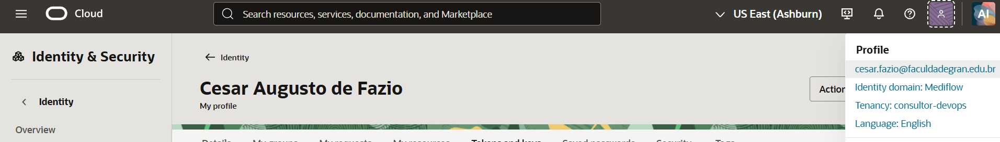
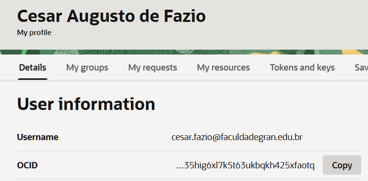
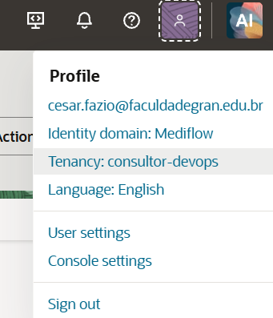
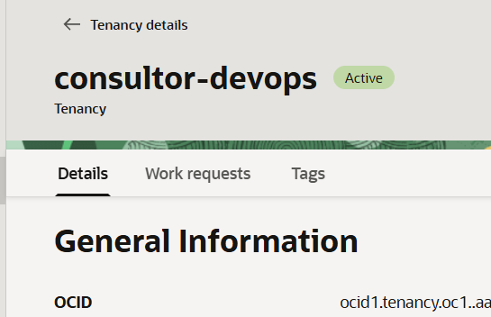

# Configurando seu OCI CLI

Siga este passo a passo para configurar o OCI CLI (Command Line Interface) no seu computador e poder usar sua chave de API para enviar e solicitar objetos ao bucket do Oracle Cloud.

## 1. Baixando o OCI CLI

Usem este comando para baixar o OCI CLI:

```Bash
bash -c "$(curl -L https://raw.githubusercontent.com/oracle/oci-cli/master/scripts/install/install.sh)
```

**Atenção:** Não use o curl -L https://raw.githubusercontent.com/oracle/oci-cli/master/scripts/install/install.sh, pois ele não funciona.

Também podem usar o Brew, caso já tenham:

```Bash
brew install oci-cli
```

## 2. Configurando seu usuário OCI

Depois de fazer a conta na Tenancy, você precisa criar uma chave de API para poder usar o OCI CLI. Para isso, siga os passos abaixo:

```Bash
oci setup config
```
Deixe vazio e aperte Enter: 

```Bash
Enter a location for your config [/home/seu_email/.oci/config]: 
```

### a. Encontre seu User OCID

Entre na sua conta da OCI.

Clique com o botão direito no seu nome no canto superior direito e clique no quadradinho com sua Inicial, e depois no seu e-mail.



Clique no botão "Copy" para copiar o seu User OCID.



Cole seu user OCID:

```Bash
Enter a user OCID: 
```

### b. Encontre seu Tenancy OCID

Clique com o botão direito no seu nome no canto superior direito e clique no quadradinho com sua Inicial, e depois na sua tenancy.



Clique no botão "Copy" para copiar o seu Tenancy OCID.



Cole seu Tenancy OCID:

```Bash
Enter a tenancy OCID: 
``` 

### c. Escolha a região

Digite o código da região (ex: us-ashburn-1) ou o índice da região (ex: 72) que você quer usar.

Você pode ver a lista completa de regiões disponíveis no site da Oracle: https://docs.oracle.com/en-us/iaas/Content/General/Concepts/regions.htm

No caso do nosso Hackathon, use a região us-ashburn-1 (ou 72).

```Bash
Enter a region by index or name(e.g.
1: af-casablanca-1, 2: af-johannesburg-1, 3: ap-batam-1, 4: ap-chiyoda-1, 5: ap-chuncheon-1,
6: ap-chuncheon-2, 7: ap-dcc-canberra-1, 8: ap-dcc-gazipur-1, 9: ap-delhi-1, 10: ap-hyderabad-1,
11: ap-ibaraki-1, 12: ap-kulai-2, 13: ap-melbourne-1, 14: ap-mumbai-1, 15: ap-osaka-1,
16: ap-seoul-1, 17: ap-seoul-2, 18: ap-singapore-1, 19: ap-singapore-2, 20: ap-suwon-1,
21: ap-sydney-1, 22: ap-tokyo-1, 23: ca-montreal-1, 24: ca-toronto-1, 25: eu-amsterdam-1,
26: eu-budapest-1, 27: eu-crissier-1, 28: eu-dcc-dublin-1, 29: eu-dcc-dublin-2, 30: eu-dcc-milan-1,
31: eu-dcc-milan-2, 32: eu-dcc-rating-1, 33: eu-dcc-rating-2, 34: eu-dcc-zurich-1, 35: eu-frankfurt-1,
36: eu-frankfurt-2, 37: eu-jovanovac-1, 38: eu-madrid-1, 39: eu-madrid-2, 40: eu-madrid-3,
41: eu-marseille-1, 42: eu-milan-1, 43: eu-paris-1, 44: eu-stockholm-1, 45: eu-turin-1,
46: eu-zurich-1, 47: il-jerusalem-1, 48: me-abudhabi-1, 49: me-abudhabi-2, 50: me-abudhabi-3,
51: me-abudhabi-4, 52: me-alain-1, 53: me-alrayyan-1, 54: me-dcc-doha-1, 55: me-dcc-muscat-1,
56: me-dubai-1, 57: me-ibri-1, 58: me-jeddah-1, 59: me-riyadh-1, 60: mx-monterrey-1,
61: mx-queretaro-1, 62: sa-bogota-1, 63: sa-riodejaneiro-1, 64: sa-santiago-1, 65: sa-saopaulo-1,
66: sa-valparaiso-1, 67: sa-vinhedo-1, 68: uk-cardiff-1, 69: uk-gov-cardiff-1, 70: uk-gov-london-1,
71: uk-london-1, 72: us-ashburn-1, 73: us-ashburn-2, 74: us-chicago-1, 75: us-gov-ashburn-1,
76: us-gov-chicago-1, 77: us-gov-phoenix-1, 78: us-langley-1, 79: us-luke-1, 80: us-newark-1,
81: us-phoenix-1, 82: us-saltlake-2, 83: us-sanjose-1, 84: us-somerset-1, 85: us-thames-1): 
```

### d. Criação de chaves SSH

Digite Y para confirmar a criação de chaves SSH (usaremos ela):

```Bash
Do you want to generate a new API Signing RSA key pair? (If you decline you will be asked to supply the path to an existing key.) [Y/n]: 
```

Deixe vazio e aperte Enter para aceitar o caminho padrão do arquivo de chave privada:

```Bash
Enter a directory for your keys to be created [/home/seu_email/.oci]: 
```
Deixe vazio e aperte Enter para aceitar o nome padrão do arquivo de chave pública (precisamos do nome padrão):

```Bash
Enter a name for your key [oci_api_key]:
```

Digite N/A para evitarmos passphrase (não é necessário para o Hackathon):

```Bash
Enter a passphrase for your private key ("N/A" for no passphrase): 
```

Digite N/A mais uma vez:

```Bash
Repeat for confirmation: 
```

Configurado! Agora você precisa criar seu token de segurança.

## 3. Criando seu token de segurança

Entre na sua conta da OCI.

```Bash
oci session authenticate
```

Vai aparecer essa tela de novo. No nosso caso, a região é us-ashburn-1 (ou 72).

```Bash
Enter a region by index or name(e.g.
1: af-casablanca-1, 2: af-johannesburg-1, 3: ap-batam-1, 4: ap-chiyoda-1, 5: ap-chuncheon-1,
6: ap-chuncheon-2, 7: ap-dcc-canberra-1, 8: ap-dcc-gazipur-1, 9: ap-delhi-1, 10: ap-hyderabad-1,
11: ap-ibaraki-1, 12: ap-kulai-2, 13: ap-melbourne-1, 14: ap-mumbai-1, 15: ap-osaka-1,
16: ap-seoul-1, 17: ap-seoul-2, 18: ap-singapore-1, 19: ap-singapore-2, 20: ap-suwon-1,
21: ap-sydney-1, 22: ap-tokyo-1, 23: ca-montreal-1, 24: ca-toronto-1, 25: eu-amsterdam-1,
26: eu-budapest-1, 27: eu-crissier-1, 28: eu-dcc-dublin-1, 29: eu-dcc-dublin-2, 30: eu-dcc-milan-1,
31: eu-dcc-milan-2, 32: eu-dcc-rating-1, 33: eu-dcc-rating-2, 34: eu-dcc-zurich-1, 35: eu-frankfurt-1,
36: eu-frankfurt-2, 37: eu-jovanovac-1, 38: eu-madrid-1, 39: eu-madrid-2, 40: eu-madrid-3,
41: eu-marseille-1, 42: eu-milan-1, 43: eu-paris-1, 44: eu-stockholm-1, 45: eu-turin-1,
46: eu-zurich-1, 47: il-jerusalem-1, 48: me-abudhabi-1, 49: me-abudhabi-2, 50: me-abudhabi-3,
51: me-abudhabi-4, 52: me-alain-1, 53: me-alrayyan-1, 54: me-dcc-doha-1, 55: me-dcc-muscat-1,
56: me-dubai-1, 57: me-ibri-1, 58: me-jeddah-1, 59: me-riyadh-1, 60: mx-monterrey-1,
61: mx-queretaro-1, 62: sa-bogota-1, 63: sa-riodejaneiro-1, 64: sa-santiago-1, 65: sa-saopaulo-1,
66: sa-valparaiso-1, 67: sa-vinhedo-1, 68: uk-cardiff-1, 69: uk-gov-cardiff-1, 70: uk-gov-london-1,
71: uk-london-1, 72: us-ashburn-1, 73: us-ashburn-2, 74: us-chicago-1, 75: us-gov-ashburn-1,
76: us-gov-chicago-1, 77: us-gov-phoenix-1, 78: us-langley-1, 79: us-luke-1, 80: us-newark-1,
81: us-phoenix-1, 82: us-saltlake-2, 83: us-sanjose-1, 84: us-somerset-1, 85: us-thames-1): 
```

Vai aparecer essa tela, e se tudo deu certo, vai aparecer um browser para autenticar. Segue um exemplo:

```Bash
    Please switch to newly opened browser window to log in!
    You can also open the following URL in a web browser window to continue:
https://login.us-ashburn-1.oraclecloud.com/v1/oauth2/authorize?action=login&client_id=iaas_console&response_type=token+id_token&nonce=xxxxxxxxxxxxxxxxx&scope=openid&public_key=xxxxxxxxxxxxxxxxxx&redirect_uri=http%3A%2F%2Flocalhost%3A8181
```

Se aparecer no final da string "Operation Not Supported", apenas copie a URL e cole no seu navegador. 

Depois de logar, vai aparecer a seguinte mensagem, para você criar seu nome de perfil.

```Bash
    Completed browser authentication process!
Enter the name of the profile you would like to create: 
```

Para sabermos se deu certo, digite o comando abaixo e veja se sua sessão está autenticada:

```Bash
oci session validate --profile <seu_nome_de_perfil> --auth security_token
```

Agora cheque se você consegue acessar um objeto do bucket do nosso hackathon. Use o comando abaixo, substituindo <seu_nome_de_perfil> pelo nome do perfil que você criou:

```Bash
 oci os object head --namespace-name idzac8al3ypr --bucket-name mediflow-documentos-clinicos --name auditoria_humana/obj_test.txt --auth security_token --profile <seu_nome_de_perfil>
```
Se aparecer um JSON com informações do objeto, então deu certo! Agora você já pode usar o OCI CLI para enviar e solicitar objetos ao bucket do nosso hackathon na Oracle Cloud.