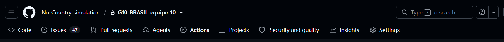
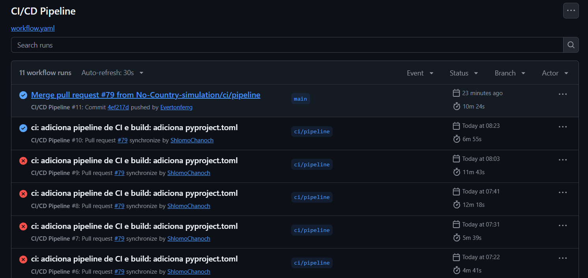
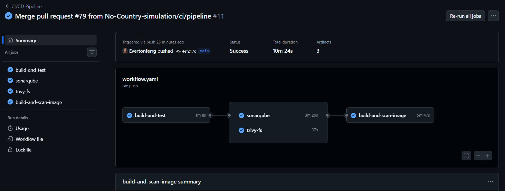
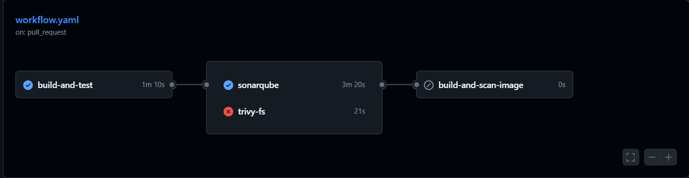
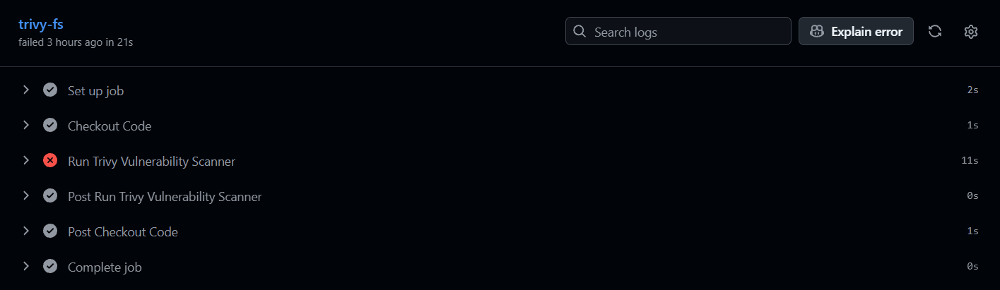

# Como usar a Pipeline do GitHub Actions

A pipeline criada no repositório do GitHub Actions é responsável por automatizar o processo de build, teste e (futuramente) deploy da aplicação. Segue um guia passo a passo para utilizar a pipeline.

## 1. Git Push e Aba Actions

Assim que você der Git Push da sua branch, a pipeline será automaticamente disparada.

Você pode acompanhar o progresso da execução da pipeline na aba "Actions" do repositório.



Essa seção é conhecida como GitHub Actions, onde você pode visualizar todas as execuções da pipeline, incluindo logs detalhados de cada etapa.

## 2. Logs e Detalhes da Execução

Ao clicar em uma execução específica da pipeline, você será direcionado para uma página detalhada que mostra o status de cada etapa do processo.





Na barra lateral esquerda encontram-se as opções de navegação do resumo (Summary), a listagem de todos os jobs e os detalhes de execução (Usage, Workflow file e Lockfile). No canto superior direito está disponível o botão para reexecutar o fluxo (Re-run all jobs).   

### Detalhes Principais da Execução

* Título do commit / execução: Merge pull request #79 from No-Country-simulation/ci/pipeline
* Gatilho/Trigger: Na imagem, é o Push do Everton ao aceitar o pull request #79. Mas o gatilho pode ser um Pull Request, Push, Schedule, etc.
* Estado: Success. Esse é o Estado que você quer que seu pull request esteja, pois significa que a pipeline foi executada com sucesso e seu código está pronto para ser mergeado.
* Duração total: 10 minutos e 24 segundos. O Workflow pode levar um pouco de tempo.

### Fluxo de Trabalho e Tarefas (Jobs)

1. `build-and-test`: Primeira etapa do fluxo, responsável pela compilação e execução dos testes do Pytest. Ele cria um arquivo de relatório de cobertura de testes (coverage.xml) que será utilizado nas etapas seguintes.
2. `sonarqube`: Análise estática da qualidade do código. Em caso de falha, corrija o código antes de enviar o pull request caso encontre problemas de qualidade no código.
3. `trivy-fs`: Verificação de vulnerabilidades no sistema das dependências do código. Importante para a segurança e compliance do projeto. Caso encontre vulnerabilidades de gravidade crítica ou alta, o job falha. Retrabalhe as dependências do projeto ou chame alguém para corrigir essas vulnerabilidades antes de fazer merge do pull request.
4. `build-and-scan-image`: Etapa focada na construção e análise de segurança da imagem do container. Usamos a imagem `wolfi` da Chainguard para evitar essas vulnerabilidades, mas mesmo assim realizamos um scan de vulnerabilidades, garantindo que não haja problemas de segurança antes do deploy.

Futuramente teremos mais etapas, como deploy e integração contínua com outros serviços.

Clicando em qualquer uma dessas etapas, você terá acesso aos logs detalhados de cada job, permitindo identificar rapidamente qualquer falha ou problema que possa ter ocorrido durante a execução da pipeline.

## 3. Verificando os Logs

Vamos usar como exemplo um job que falhou, o `trivy-fs`. Ao clicar nele, você verá os logs detalhados da execução.



Basta clicar na bolinha vermelha ❌ pra vermos o que falhou. No caso do job `trivy-fs`, ele falhou devido a vulnerabilidades de gravidade alta encontradas nas dependências do projeto.



Exemplo de vulnerabilidades encontradas:

```
  ======================
  Total: 11 (MEDIUM: 0, HIGH: 11, CRITICAL: 0)
  
  ┌─────────┬─────────────────┬──────────┬────────┬───────────────────┬───────────────┬──────────────────────────────────────────────────────────────┐
  │ Library │  Vulnerability  │ Severity │ Status │ Installed Version │ Fixed Version │                            Title                             │
  ├─────────┼─────────────────┼──────────┼────────┼───────────────────┼───────────────┼──────────────────────────────────────────────────────────────┤
  │ pyasn1  │ CVE-2026-119194 │ HIGH     │ fixed  │ 0.6.4             │ 0.6.5         │ pyasn1: pyasn1: Denial of Service via hash collisions in     │
  │         │                 │          │        │                   │               │ schemaless decoding                                          │
  │         │                 │          │        │                   │               │ https://avd.aquasec.com/nvd/cve-2026-119194                  │
  │         ├─────────────────┤          │        │                   │               ├──────────────────────────────────────────────────────────────┤
  │         │ CVE-2026-119195 │          │        │                   │               │ pyasn1: pyasn1: Denial of Service via quadratic processing   │
  │         │                 │          │        │                   │               │ of fragmented ASN.1 data...                                  │
  │         │                 │          │        │                   │               │ https://avd.aquasec.com/nvd/cve-2026-119195                  │
  │         ├─────────────────┤          │        │                   │               ├──────────────────────────────────────────────────────────────┤
  │         │ CVE-2026-119196 │          │        │                   │               │ pyasn1: pyasn1: Denial of Service via constructed bit string │
  │         │                 │          │        │                   │               │ decoding                                                     │
  │         │                 │          │        │                   │               │ https://avd.aquasec.com/nvd/cve-2026-119196                  │
  │         ├─────────────────┤          │        │                   │               ├──────────────────────────────────────────────────────────────┤
  │         │ CVE-2026-119197 │          │        │                   │               │ pyasn1: pyasn1: Denial of Service via quadratic complexity   │
  │         │                 │          │        │                   │               │ in binary REAL decoding...                                   │
  │         │                 │          │        │                   │               │ https://avd.aquasec.com/nvd/cve-2026-119197                  │
  ├─────────┼─────────────────┤          │        ├───────────────────┼───────────────┼──────────────────────────────────────────────────────────────┤
  │ pypdf   │ CVE-2026-119203 │          │        │ 6.21.2            │ 6.21.4        │ pypdf: pypdf: Denial of Service via infinite loop on crafted │
  │         │                 │          │        │                   │               │ incomplete PDF...                                            │
  │         │                 │          │        │                   │               │ https://avd.aquasec.com/nvd/cve-2026-119203                  │
  │         ├─────────────────┤          │        │                   │               ├──────────────────────────────────────────────────────────────┤
  │         │ CVE-2026-119204 │          │        │                   │               │ pypdf: pypdf: Denial of Service via excessive memory         │
  │         │                 │          │        │                   │               │ consumption during PDF parsing...                            │
  │         │                 │          │        │                   │               │ https://avd.aquasec.com/nvd/cve-2026-119204                  │
  │         ├─────────────────┤          │        │                   │               ├──────────────────────────────────────────────────────────────┤
  │         │ CVE-2026-119205 │          │        │                   │               │ pypdf: pypdf: Denial of Service via infinite loop during     │
  │         │                 │          │        │                   │               │ dictionary cloning                                           │
  │         │                 │          │        │                   │               │ https://avd.aquasec.com/nvd/cve-2026-119205                  │
  │         ├─────────────────┤          │        │                   ├───────────────┼──────────────────────────────────────────────────────────────┤
  │         │ CVE-2026-119206 │          │        │                   │ 6.21.3        │ pypdf: pypdf: Denial of Service via crafted PDF page labels  │
  │         │                 │          │        │                   │               │ https://avd.aquasec.com/nvd/cve-2026-119206                  │
  │         ├─────────────────┤          │        │                   │               ├──────────────────────────────────────────────────────────────┤
  │         │ CVE-2026-119207 │          │        │                   │               │ pypdf: pypdf: Denial of Service via crafted invalid PDF      │
  │         │                 │          │        │                   │               │ dictionary                                                   │
  │         │                 │          │        │                   │               │ https://avd.aquasec.com/nvd/cve-2026-119207                  │
  │         ├─────────────────┤          │        │                   │               ├──────────────────────────────────────────────────────────────┤
  │         │ CVE-2026-119208 │          │        │                   │               │ pypdf: pypdf: Denial of Service via forged page count in     │
  │         │                 │          │        │                   │               │ encrypted PDFs...                                            │
  │         │                 │          │        │                   │               │ https://avd.aquasec.com/nvd/cve-2026-119208                  │
  │         ├─────────────────┤          │        │                   │               ├──────────────────────────────────────────────────────────────┤
  │         │ CVE-2026-119209 │          │        │                   │               │ pypdf: pypdf: Denial of Service via crafted cross-reference  │
  │         │                 │          │        │                   │               │ streams                                                      │
  │         │                 │          │        │                   │               │ https://avd.aquasec.com/nvd/cve-2026-119209                  │
  └─────────┴─────────────────┴──────────┴────────┴───────────────────┴───────────────┴──────────────────────────────────────────────────────────────┘
```

No exemplo, 11 vulnerabilidades foram encontradas, todas de gravidade alta. O job `trivy-fs` falhou, impedindo o merge do pull request até que essas vulnerabilidades sejam resolvidas.

Para nossa sorte, apenas duas dependências precisavam ser atualizadas para que o job `trivy-fs` passe com sucesso. No caso, foi só atualizar o `pyasn1` para 0.6.5 e o `pypdf` para 6.21.4 no `requirements.txt` (**NÃO use o `´pyproject.toml` neste projeto específico**), fazer commit e push.

A pipeline roda de novo automaticamente.

### E se não houver correção?

Se a coluna “Fixed Version” vier vazia, vale citar e pedir justificativa no PR.

## Dica

Rode localmente antes! Como a pipeline leva uns 10 minutos, rode `pytest` (e, se der, `trivy fs .`) localmente antes do push economiza o seu tempo.
